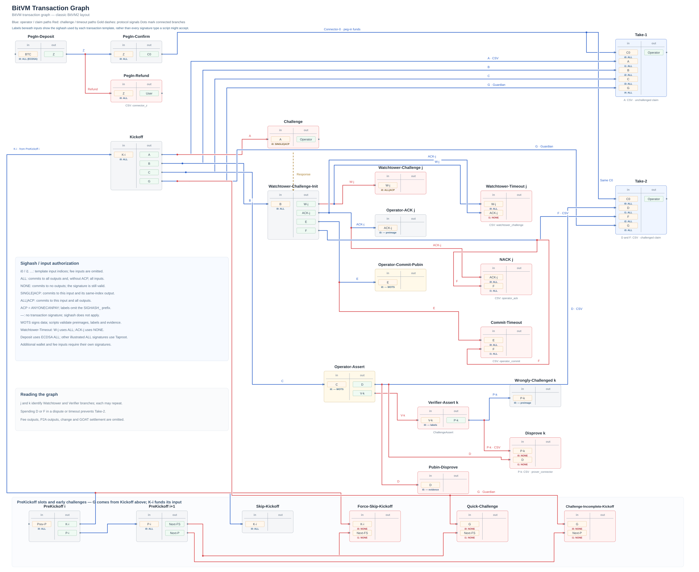

# GOAT BitVM Node

GOAT Network's BitVM bridge implementation connects Bitcoin and GOAT L2 through
presigned transaction graphs, optimistic verification, and proof-based disputes.
See the [GOAT BitVM Whitepaper](https://www.goat.network/bitvm2-whitepaper) for
protocol background.

## Transaction graph

[](transaction-graph.svg)

Open the [full-size graph](transaction-graph.svg) for peg-in, Operator claims,
Watchtower and Verifier challenges, timeouts, and PreKickoff paths. Blue lines
show Operator and claim transactions; red lines show challenges and timeouts.
Dots join branches; crossings without dots do not.

## Guides

- [Node](node/README.md) — roles and execution
- [Circuits](circuits/README.md) — proof composition and compatibility
- [Proof Builder](proof-builder-rpc/README.md) — proof coordination and recovery
- [Deployment](deployment/README.md) — running bridge participants
- [Localnet](localnet/README.md) — local testing
- [End-to-end checks](localnet/e2e/README.md) — protocol and fault scenarios
- [Operator tools](scripts/ops/README.md) — read-only diagnosis

## Transaction graph checks

Rust tests check connector wiring, competing spends, and CSV values. TLA+ models
check timing and core dispute safety, including invalid assertions, unpublished
public inputs, and late assertions after Connector F has matured.

```bash
make tla-setup
cargo test -p bitvm-gc --test transaction_graph_invariants --test tla_shipped_values
make tla
```

After changing timing constants, run `make tla-values` before checking the models.
Every model-checking failure fails CI. These checks rely on bounded response
assumptions and do not establish end-to-end bridge safety or liveness; fees,
relay policy, reorgs, cryptography, and contract settlement need separate review.

## Contributing

Open an issue or pull request with a concrete problem, proposed change, and
relevant validation.
