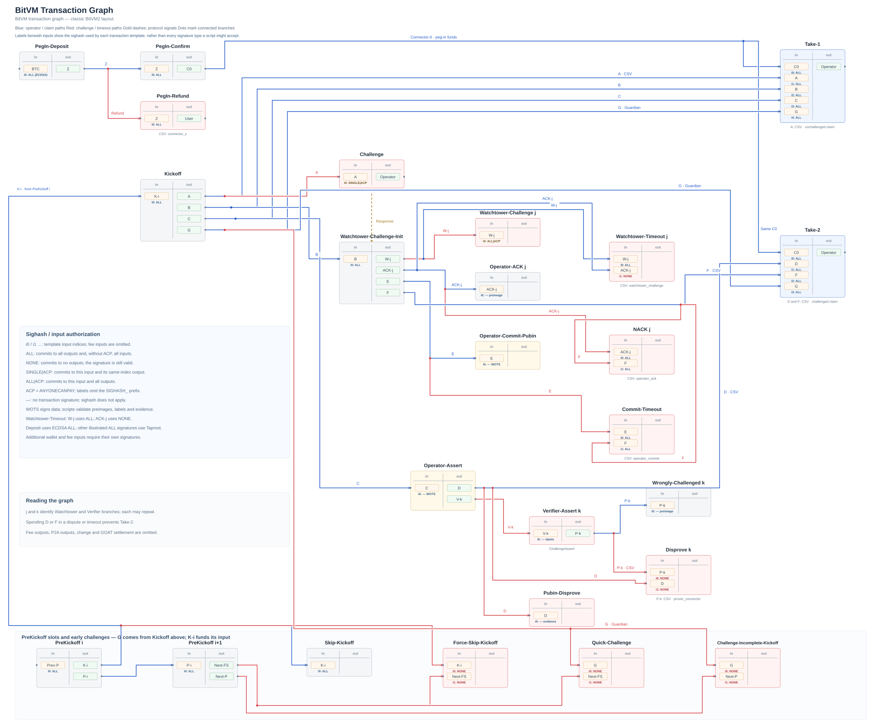

# BitVM Node

`bitvm-noded` runs the Bitcoin and GOAT L2 bridge protocol: chain monitoring,
transaction graph setup and signing, P2P communication, and proof coordination.

## Contents

- [Transaction graph](#bitcoin-transaction-graph)
- [Roles](#roles)
- [Execution and storage](#execution-and-storage)
- [Build & Run](#build--run)
- [Configuration](#configuration)
- [Related documentation](#related-documentation)

## Bitcoin transaction graph

[](../transaction-graph.svg)

Open the [full-size SVG](../transaction-graph.svg) for connector wiring, CSV
paths, competing spends, PreKickoff slots, and per-input authorization types.
Blue paths show operator and claim transactions; red paths show challenges and
timeouts. Dots join branches; crossings without dots do not.

- **Peg-in:** PegIn-Deposit funds Z. PegIn-Confirm creates C0; PegIn-Refund is
  the competing refund path.
- **Claims:** Take-1 reimburses the Operator after A's CSV delay. Take-2 requires
  C0, D, F and G and must satisfy both D's and F's CSV delays.
- **Disputes:** Watchtower and Verifier branches can prevent a claim by spending
  its required outputs. Verifier-Assert is also called ChallengeAssert;
  Pubin-Disprove spends D directly.

The SVG's legend explains `ALL`, `NONE`, `SINGLE`, `ACP`, and inputs authorized
without a transaction signature. Fee inputs and GOAT settlement are omitted.

## Roles

| Role | Responsibility |
|------|----------------|
| Committee | Presign transactions and endorse peg-ins and graphs |
| Operator | Build graphs, publish assertions, and execute Bitcoin claims |
| Verifier | Prepare circuits, verify assertions, and submit disproofs |
| Watchtower | Monitor Bitcoin and submit Watchtower challenges |
| Relayer | Committee mode that posts data to GOAT and serves graph requests |

Set `ACTOR` to the node's role. Committee nodes enable relaying with
`ENABLE_RELAYER=true`.

## Execution and storage

Chain observations, admitted P2P messages, and job results enter a durable inbox.
Instance and Graph aggregates apply events in SQLite transactions and produce
outbox messages or leased jobs. Heavy setup, signing, proof work, and network
calls run in jobs; their results return through the inbox.

The Instance aggregate handles peg-in validation and signing. The Graph aggregate
handles graph setup, presigning, Bitcoin claims, and disputes. Chain scans supply
the facts used to advance their state.

SQLite stores graph metadata in `graph`, serialized definitions in
`graph_raw_data`, and execution state in the engine tables. Missing graph
definitions are fetched directly with `GetGraph` from relayers, committee
members, or the Operator and authenticated before use. Gossip carries setup
messages and acknowledgements.

## Build & Run

### Build Commands

```bash
# Build for regtest
BITCOIN_NETWORK=regtest cargo build -r

# Build for testnet4
BITCOIN_NETWORK=testnet4 cargo build -r

# Build only the node binary
cargo build -r -p bitvm-noded
```

### Local testnets

```bash
cargo build -r -p bitvm-noded --features "rpc-debug-endpoints mock-gc" --bins
```

`mock-gc` replaces proof machinery with deterministic mocks for local testing.
Use it only on local testnets. See the [localnet guide](../localnet/README.md)
for setup and end-to-end scenarios.

### Generate Node Keys

```bash
# Generate P2P peer key
bitvm-noded key peer
# Output:
# PEER_KEY=<base64-encoded-key>
# PEER_ID=<peer-id>

# Generate funding address (for Operator/Verifier)
bitvm-noded key funding-address
# Output:
# Funding P2WSH address: bc1q...
```

### Start Node

```bash
bitvm-noded \
  --rpc-addr 0.0.0.0:8080 \
  --metrics-addr 127.0.0.1:9108 \
  --db-path ./node.db \
  --p2p-port 4001 \
  --bootnodes '/ip4/x.x.x.x/tcp/4001/p2p/<peer_id>'
```

### Start Local Mock RPC

Use this when you only need to test HTTP interfaces. It starts the RPC routes without
P2P, chain watchers, or maintenance tasks, and seeds a local SQLite database with
mock nodes, instances, graphs, and overview data.

```bash
cargo run -p bitvm-noded --bin mock-rpc -- --rpc-addr 127.0.0.1:18080
```

Useful test calls:

```bash
curl http://127.0.0.1:18080/v1/nodes/overview
curl http://127.0.0.1:18080/v1/instances
curl http://127.0.0.1:18080/v1/swaps
curl http://127.0.0.1:18080/v1/graphs
```

The mock binary prints seeded instance and graph IDs on startup. Endpoints that
require real `graph_raw_data`, such as graph transaction hex export, still need
real graph raw data in the database.

### CLI Options

| Option | Description | Default |
|--------|-------------|---------|
| `--rpc-addr` | RPC service bind address | `0.0.0.0:8080` |
| `--db-path` | SQLite database path | `sqlite:/tmp/bitvm-node.db` |
| `--p2p-port` | P2P listen port | `0` (random) |
| `--bootnodes` | Bootstrap node addresses | - |
| `--metrics-addr` | Dedicated Prometheus listener address | Disabled |
| `--metrics-path` | Path served by the dedicated metrics listener | `/metrics` |
| `--enable-kademlia` | Enable Kademlia DHT | `true` |

## Configuration

### Environment Variables

| Variable | Required | Description | Default |
|----------|----------|-------------|---------|
| `ACTOR` | Yes | Node role: `Committee`, `Operator`, `Verifier`, `Watchtower` | `Verifier` |
| `BITCOIN_NETWORK` | Yes | Bitcoin network: `bitcoin`, `testnet4`, `signet`, `regtest` | `testnet4` |
| `GOAT_NETWORK` | Yes | GOAT network: `main`, `test` | `test` |
| `GOAT_CHAIN_URL` | Yes | GOAT L2 RPC endpoint | - |
| `GOAT_GATEWAY_CONTRACT_ADDRESS` | Yes | Gateway contract address | - |
| `BITVM_SECRET` | Yes | Node private key or seed (`seed:xxx` format) | - |
| `PEER_KEY` | Yes | libp2p node key (Base64 encoded) | - |
| `GOAT_PRIVATE_KEY` | Conditional | GOAT chain private key (required for Committee) | - |
| `GOAT_ADDRESS` | Conditional | GOAT address (required for Operator/Verifier) | - |
| `ENABLE_RELAYER` | No | Enable relayer mode for Committee nodes | `false` |
| `ENABLE_BABE_SETUP_STATE_CLEANUP` | No | Enable scheduled BABE setup state cleanup for Operator/Verifier nodes | `false` |
| `BTC_CHAIN_URL` | No | Bitcoin Esplora API endpoint | Public Esplora |
| `NODE_NAME` | No | Node display name | `ZKM` |
| `OPERATOR_NODE_SERVICE_FEE` | No | Operator service fee rate | `0.001` |
| `ENABLE_COMMITTEE_INSTANCE_KEY_DELETE` | No | Delete the committee instance key envelope when the instance fails (except `Timeout`) or 32 blocks after the Peg-In-Confirm confirmed; off, the intent is only logged | `false` |
| `COMMITTEE_INSTANCE_KEY_DELETE_TIMELOCK_BLOCKS` | No | Number of BTC blocks to wait after pegin-confirm confirmation before deleting key envelope; deletion also waits until Prepare height + T0 | `32` |
| `PEGIN_ABANDON_BUFFER_BLOCKS` | No | Blocks after `Prepare height + connector_z` before an instance whose Peg-In-Confirm is neither confirmed nor in the mempool is abandoned | `18` / `14` / `3` / `6` by network |
| `OPERATOR_GRAPH_START_CUTOFF_BLOCKS` | No | Operators start no new graph for an instance past `Prepare height + cutoff` | `⌊2·connector_z/3⌋` |
| `ENGINE_WORKER_COUNT` / `ENGINE_CPU_POOL_SLOTS` / `ENGINE_PEGOUT_POOL_SLOTS` / `ENGINE_NETWORK_POOL_SLOTS` | No | Execution engine: aggregate workers, concurrent CPU-bound setup jobs, concurrent CPU-bound peg-out jobs (own slots, so a graph build never delays a challenge), concurrent network jobs | `1` / `1` / `1` / `4` |
| `ENGINE_APPLY_TIMEOUT_SECS` / `ENGINE_RECHECK_INTERVAL_SECS` | No | Execution engine: apply budget (also the SQLite busy timeout) and the re-check of waiting events | `120` / `60` |
| `P2P_MAX_JSON_MESSAGE_BYTES` | No | Largest JSON gossip message accepted | `2 MiB` |
| `P2P_INBOX_MAX_QUEUED_BYTES` | No | Payload bytes of admitted network events the engine inbox may hold (the committee reserve and per-peer quotas derive from it; unregistered authors are relayed, never stored) | `2 GiB` |
| `P2P_MAX_INCOMING_CONNECTIONS` / `P2P_INBOUND_REGISTERED_RESERVE` | No | Inbound connection ceiling and the slots reserved for registered peers | `512` / `128` |
| `P2P_RESERVED_PEERS` / `P2P_TRUSTED_OPERATOR_BINDINGS` | No | Peers that always get a connection slot; configured operator key bindings | empty |
| `P2P_LISTEN_IP` | No | Interface the p2p listener binds to; `127.0.0.1` keeps a node on a shared host loopback-only | `0.0.0.0` |
| `BTC_REQUEST_TIMEOUT_SECS` / `GOAT_RPC_TIMEOUT_SECS` | No | Per-request timeout of the Esplora and GOAT RPC clients, seconds (clamped to 1–120) | `15` / `20` |
| `HTTP_REQUEST_TIMEOUT_SECS` | No | Whole-request timeout of the proof-builder HTTP client, seconds (clamped to 1–600); the connect timeout is 10 s | `60` |
| `MAINTENANCE_SUBTASK_TIMEOUT_SECS` | No | Timeout for each maintenance subtask; timed-out subtasks record `timed_out` and later subtasks still run. BTC scans use a separate serial loop. Operator balances refresh 32 verified bindings per pass, plus the local operator; pending peg-ins use `INSTANCE_MAINTENANCE_BATCH_SIZE`. Both advance their cursor before each item, and give each item the BTC and GOAT client timeouts of its backend calls plus 5 s | `60` |

### Relayer Configuration

To run a Committee node as a graph data relayer:

```bash
export ACTOR=Committee
export ENABLE_RELAYER=true
export GOAT_PRIVATE_KEY='your-private-key'
# ... other required variables
```

## Related documentation

- [Project README](../README.md) — project layout and transaction graph checks
- [Localnet guide](../localnet/README.md) — local testing
- [Proof Builder RPC](../proof-builder-rpc/README.md) — proof service
- [Circuits README](../circuits/README.md) — proof generation
- [Deployment guide](../deployment/README.md) — deployment
- [Incentives](../docs/incentives.md) — incentives
