# BitVM Node

The main node implementation for GOAT Network's BitVM bridge protocol. This module handles P2P networking, message processing, scheduled tasks, and RPC services for secure cross-chain asset transfers between Bitcoin and GOAT L2.

## Table of Contents

- [Overview](#overview)
- [Architecture](#architecture)
- [Actor System](#actor-system)
- [Core Workflows](#core-workflows)
  - [Peg-in (Bridge-In)](#peg-in-bridge-in)
  - [Peg-out (Bridge-Out)](#peg-out-bridge-out)
  - [Challenge Process](#challenge-process)
- [Graph State Machine](#graph-state-machine)
- [Graph Storage & Synchronization](#graph-storage--synchronization)
- [Message System](#message-system)
- [Scheduled Tasks](#scheduled-tasks)
- [Module Structure](#module-structure)
- [Build & Run](#build--run)
- [Configuration](#configuration)
- [RPC API](#rpc-api)

---

## Overview

The BitVM Node (`bitvm-noded`) is a multi-role distributed node that participates in the BitVM cross-chain bridge protocol. It enables trustless Bitcoin-to-L2 transfers through a combination of:

- **Multi-signature Consensus**: Committee-based transaction presigning
- **Optimistic Verification**: Watchtower monitoring with dispute resolution
- **ZK Proofs**: Cryptographic verification of state transitions
- **P2P Graph Distribution**: graph definitions are pulled directly from relayers, committee members or the operator (`GetGraph` request-response)

### Key Capabilities

| Capability | Description |
|------------|-------------|
| **P2P Communication** | libp2p-based gossip network (Kademlia DHT + Gossipsub) plus a direct `GetGraph` protocol |
| **Chain Monitoring** | Bitcoin and GOAT L2 event watching |
| **Execution Engine** | One durable inbox, single-writer aggregates (instance, graph), one outbox, leased jobs (`crates/engine`) |
| **Graph Management** | Transaction graph creation, signing, and lifecycle tracking |
| **Challenge Processing** | Watchtower challenges and dispute resolution |
| **Proof Coordination** | ZK proof generation via proof-builder-rpc |

---

## Architecture

### Fig-01-1-System-Architecture

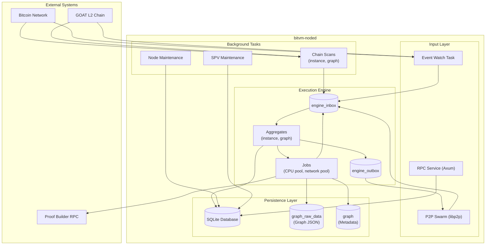

**Description**: Every input (an admitted P2P message, a chain event, a chain scan at a block height, a job result) is recorded once in `engine_inbox` and applied by the single-writer aggregate it belongs to (`instance:<id>` or `graph:<id>`) inside one SQLite transaction together with its effects: outbox rows, jobs and `waiting_for` registrations. The outbox is the only sender; it re-publishes until the aggregate closes the row. Heavy work (circuit setup, graph building, signing, proof verification, chain calls) runs in leased jobs whose results come back as inbox events. See `docs/node-protocol.md` §4–§5 and §10.

### Fig-01-2-Component-Interaction

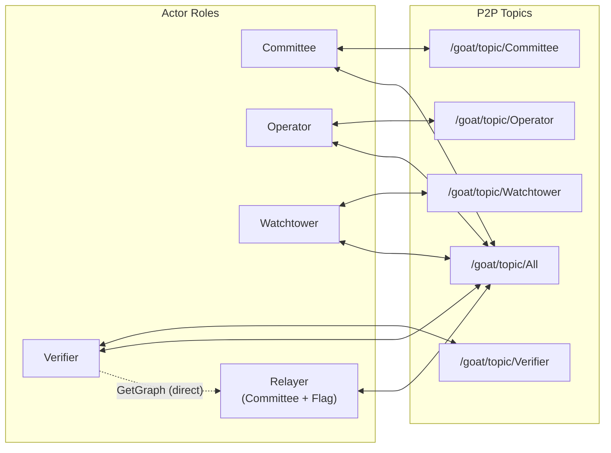

**Description**: Each role subscribes to its corresponding gossipsub topic for message exchange. All roles subscribe to the `/All` topic for broadcast messages. Graph definitions are not gossiped on request: a node that lacks one asks a relayer, a committee member or the operator directly over the `GetGraph` request-response protocol and authenticates what it receives. Relayer nodes (Committee members with `ENABLE_RELAYER=true`) post graph data to GOAT and serve as the second pull source.

---

## Actor System

BitVM employs four primary actor roles plus an optional relayer capability:

### Fig-02-1-Actor-Roles

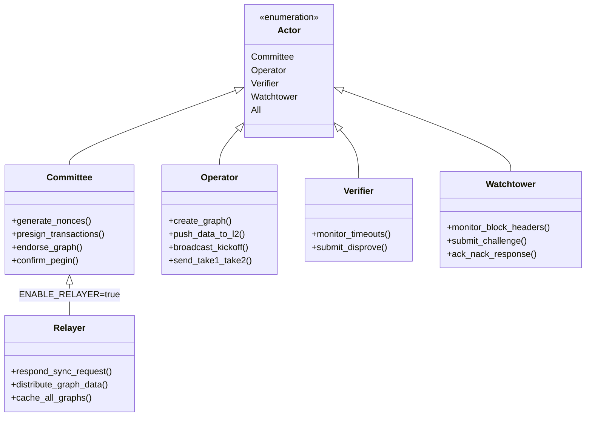

**Description**: The class diagram shows the inheritance relationship between the Actor enumeration and role implementations. Relayer is a special mode of Committee nodes enabled via environment variable.

### Role Responsibilities

| Role | Responsibilities | Key Messages |
|------|------------------|--------------|
| **Committee** | Multi-sig committee member, responsible for presigning, graph endorsement and the Peg-In-Confirm signature | `NonceGeneration`, `CommitteePresign`, `EndorseGraph`, `PeginConfirmPartialSig` |
| **Operator** | Bridge operator, creates graphs and executes withdrawal transactions (kickoff, takes are Bitcoin transactions driven by chain scans) | `InitGraph`, `CreateGraph`, `GraphFinalize` |
| **Verifier** | Dispute verifier, builds and solders circuits, monitors timeouts and submits disproofs | `GenCircuits`, `SolderingProofReady`, `VerifierGraphParamsEndorsement` |
| **Watchtower** | Chain monitor, validates block headers and submits challenges | (chain scans only) |
| **Relayer** | Committee member that posts peg-in and graph data to GOAT and serves `GetGraph` pulls | `GetGraph` (direct protocol) |

---

## Core Workflows

### Peg-in (Bridge-In)

Users deposit BTC into the bridge contract and receive equivalent assets on GOAT L2.

#### Fig-03-1-Pegin-Sequence

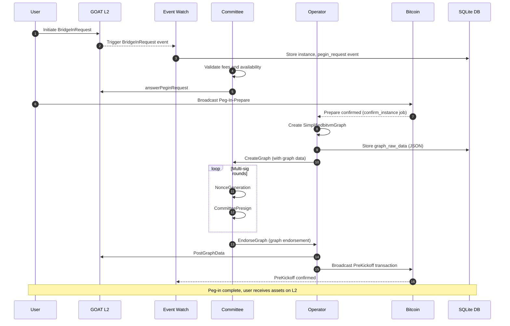

**Description**: The Peg-in flow consists of three phases: (1) Request Phase - user initiates request on L2, committee validates; (2) Graph Construction Phase - Operator creates transaction graph (stored locally in SQLite), committee performs MuSig2 multi-signing; (3) Confirmation Phase - data posted to L2, PreKickoff transaction confirms to complete the process.

#### Fig-03-2-Instance-BridgeIn-Status

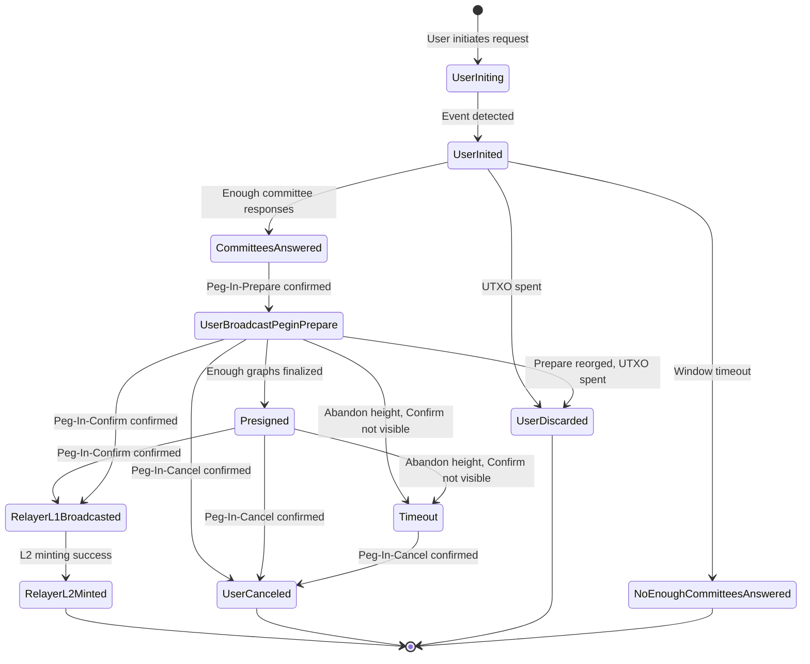

**Description**: This state diagram shows the complete lifecycle of a bridge-in instance, from initial request through committee validation, signing, and final minting on L2. Every deadline is a Bitcoin height: from `Prepare height + connector_z` (T0) no node signs for the instance and the user may cancel; `PEGIN_ABANDON_BUFFER_BLOCKS` later the instance is abandoned (`Timeout`) unless the Peg-In-Confirm is confirmed or visible in the mempool. `Timeout` is a failure terminal that keeps the committee key for manual handling; the other failure states delete it (see `docs/node-protocol.md` §10.2).

### Peg-out (Bridge-Out)

Users initiate withdrawal on GOAT L2 and receive BTC on Bitcoin. Two paths exist:

#### Fig-03-3-Pegout-Happy-Path

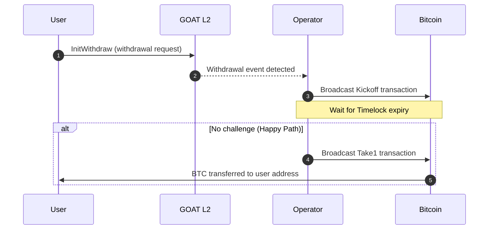

**Description**: The Happy Path is the simplest route - when no Watchtower challenges the Operator's claim, the Operator completes the withdrawal via Take1 transaction after the Timelock expires.

#### Fig-03-4-Pegout-Challenge-Path

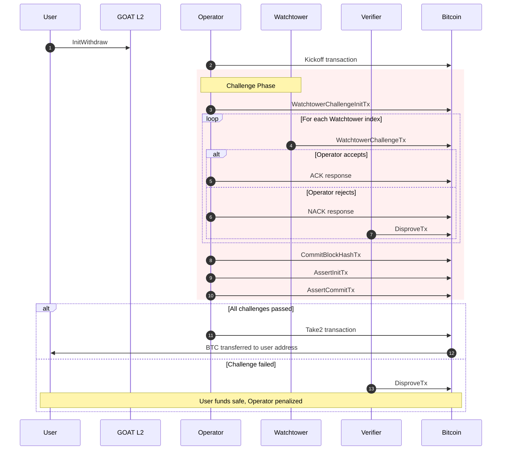

**Description**: The Challenge Path is triggered when Watchtowers detect anomalies. It contains three sub-phases: (1) Watchtower Challenge - watchers submit challenges; (2) BlockHash Commit - Operator commits block hash; (3) Assert Commit - Operator commits assertion proofs. Failure in any phase triggers Disprove.

### Challenge Process

#### Fig-03-5-Challenge-Substatus

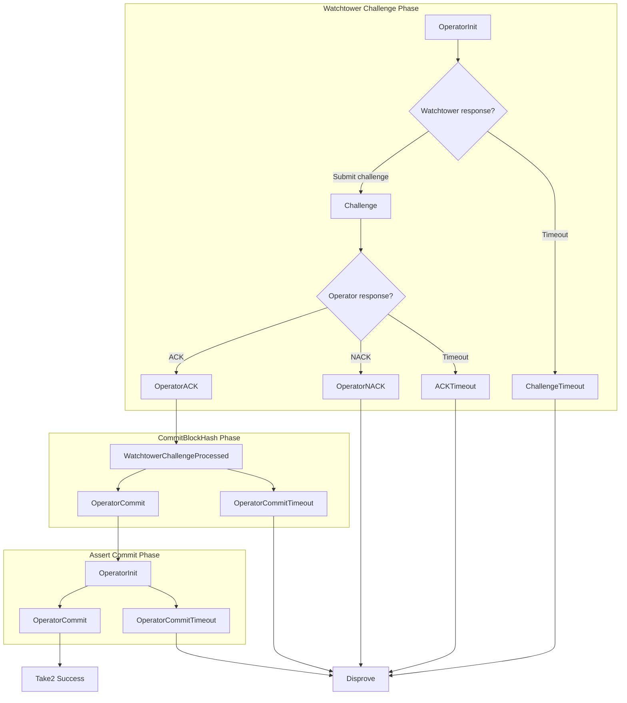

**Description**: The challenge process tracks three parallel state machines. Any timeout or failure in sub-phases triggers the Disprove path, ensuring system security.

---

## Graph State Machine

Graph is the core data structure in BitVM, representing a set of presigned Bitcoin transactions.

### Fig-04-1-Graph-Lifecycle

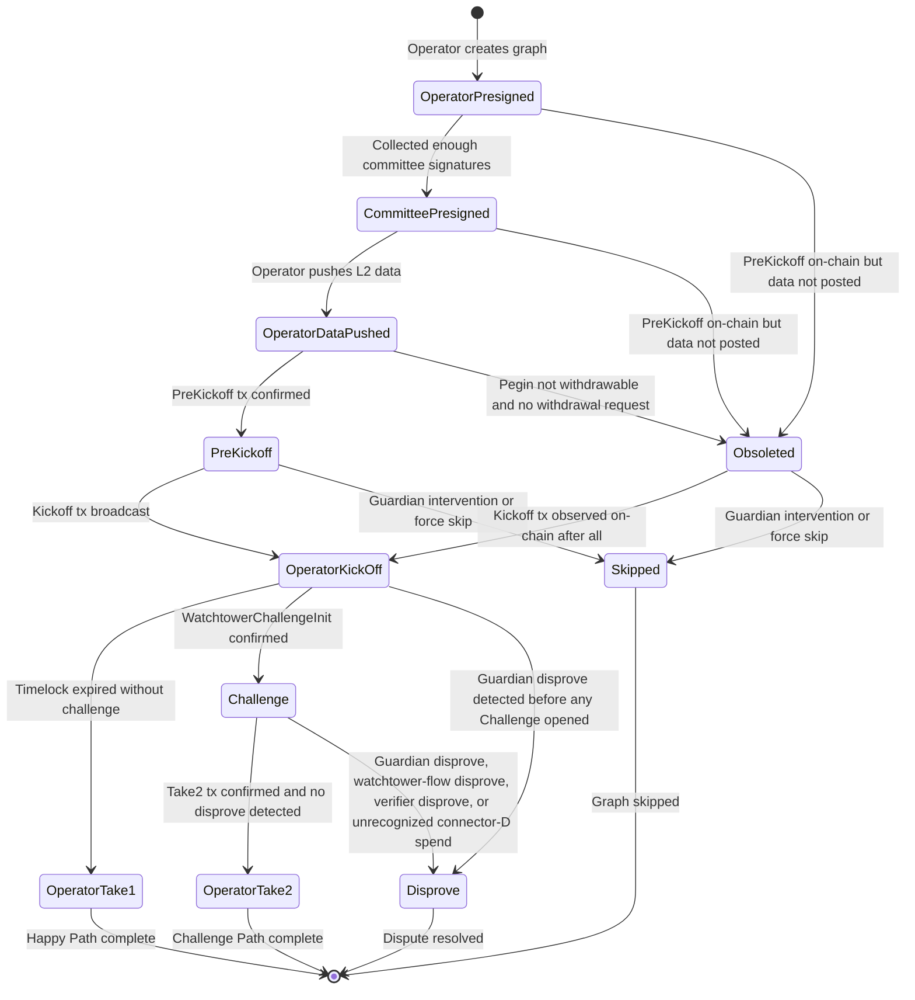

**Description**: Graph goes through 9 main states. The normal flow starts from `OperatorPresigned`, proceeds through signature collection, data publishing, and Kickoff, finally completing via Take1 (Happy Path) or Take2 (Challenge Path). `Skipped` and `Disprove` are terminal.

**`Obsoleted` is not terminal.** It is a provisional status: the local node marks a graph `Obsoleted` when it observes the PreKickoff tx on-chain before graph data was posted (or the pegin becomes non-withdrawable), but if it later observes the actual kickoff tx confirm, the graph resumes into `OperatorKickOff` exactly as if it had come from `PreKickoff` — see `scan_graph_chain_state`, `node/src/utils.rs:1418-1434`, which checks `matches!(current_status, GraphStatus::PreKickoff | GraphStatus::Obsoleted)` for both the kickoff and force-skip cases.

`OperatorKickOff --> Disprove` is a direct edge, distinct from the `Challenge --> Disprove` edge below: a guardian can detect and prove operator misbehavior (`detect_guardian_disprove`, `node/src/utils.rs:1237-1262`) before a watchtower ever opens a `Challenge` at all (`node/src/utils.rs:1448-1461`).

### Fig-04-2-Graph-Status-Transitions

| Source State | Target State | Trigger Condition |
|--------------|--------------|-------------------|
| `OperatorPresigned` | `CommitteePresigned` | Received enough committee presignatures |
| `OperatorPresigned` | `Obsoleted` | PreKickoff on-chain but graph data not posted |
| `CommitteePresigned` | `OperatorDataPushed` | Operator successfully pushed data to L2 |
| `OperatorDataPushed` | `PreKickoff` | PreKickoff tx confirmed on Bitcoin |
| `OperatorDataPushed` | `Obsoleted` | Pegin not withdrawable and no withdrawal request |
| `PreKickoff` | `OperatorKickOff` | Kickoff tx broadcast successfully |
| `PreKickoff` | `Skipped` | Guardian intervention or force skip |
| `Obsoleted` | `OperatorKickOff` | Kickoff tx broadcast successfully (Obsoleted is provisional, not terminal) |
| `Obsoleted` | `Skipped` | Guardian intervention or force skip |
| `OperatorKickOff` | `OperatorTake1` | Connector-A spent by the take1 tx |
| `OperatorKickOff` | `Challenge` | Connector-A spent by anything other than the take1 tx |
| `OperatorKickOff` | `Disprove` | Guardian disprove detected (bypasses `Challenge`) |
| `Challenge` | `OperatorTake2` | Take2 tx observed on-chain and no disprove detector fired |
| `Challenge` | `Disprove` | Any of: guardian disprove, watchtower-flow disprove (operator-challenge-nack or operator-commit-timeout tx), a verifier's assert answered by its matching disprove tx, or an unrecognized connector-D spend |

Source: `scan_graph_chain_state`, `node/src/utils.rs:1328-1681` (the sole writer of these edges; verified by full read, 2026-07-17).

### Fig-04-3-Challenge-SubStatus

`ChallengeSubStatus` is **not** three parallel single-value status enums as earlier revisions of this document claimed — that shape does not exist in the code. The actual struct (`node/src/aggregates/graph_scan.rs`) is:

```rust
pub struct ChallengeSubStatus {
    pub watchtower_challenge_status: Vec<bool>,                  // per-watchtower: true once that watchtower's challenge connector is spent
    pub verifier_challenge_status: Vec<VerifierChallengeStatus>, // per-verifier progress
    pub disprove_type: Option<DisproveTxType>,
    pub disprove_index: i32,
}

pub enum VerifierChallengeStatus { None, VerifierAsserted, ProverAnswered, Disproved }

pub enum DisproveTxType { Disprove, QuickChallenge, ChallengeIncompleteKickoff, PubinDisprove, OperatorChallengeNack, OperatorCommitTimeout }
```

`watchtower_challenge_status` and `verifier_challenge_status` are **observational bookkeeping only** — they are recorded for the frontend/API (`node/src/rpc_service/bitvm.rs:672-693`, collapsed there into a simpler `SimpleChallengeSubStatus{None, WatchtowerChallenge, Assert}` view) but are never read by anything that decides `GraphStatus`.  The real `Challenge --> OperatorTake2` gate is purely `tx_on_chain(take2_txid)` after none of the four disprove detectors fired (`node/src/utils.rs:1661-1670`); the operator's actual authorization to broadcast take2 is enforced by Bitcoin-script timelocks (the `take2` job re-checks them), not by any application-level quorum over watchtower or verifier counts.

### Known gap: no ordering guarantee between chain-scan and L2-event writers

`GraphStatus` is written from two independently-scheduled places with no inherent coordination between them:
- `scan_graph_chain_state` above (Bitcoin-poll derived), and
- the GoatChain L2-event watcher, `node/src/scheduled_tasks/event_watch_task.rs:392-502`, which writes `OperatorDataPushed`/`OperatorTake1`/`OperatorTake2`/`Disprove` directly via `StorageProcessor::update_graph` with no precondition on the graph's current status.

Both currently go through a raw `UPDATE graph SET status = ?` (`crates/store/src/localdb.rs`) with no guard preventing a closed/terminal status (`GraphStatus::is_closed()`: `OperatorTake1`, `OperatorTake2`, `Skipped`, `Disprove`) from being overwritten by a later, differently-ordered write from the other subsystem — e.g. a `Disprove` status can be silently reverted by a stale `PostGraphDataEvent` replay. **This is an open bug, not yet fixed in code.**

`node/tla/GraphLifecycle.tla` / `GraphLifecycle.cfg` has the machine-checked counterexample (`OperatorTake1 -> OperatorTake2` in 2 steps). A verified fix design exists and is formally proven correct — `GraphLifecycleFixed.cfg` (atomic guard: fold the check into the `UPDATE`'s `WHERE status IN (...)` clause rather than a separate read-then-decide-then-write) passes all safety and liveness properties, and `GraphLifecycleFineGrainedFixed.tla` additionally proves that atomicity is necessary (a naive read-then-write version of the same guard, modeled in `GraphLifecycleFineGrained.tla`, still fails). Applying that design to `node/src/utils.rs`/`crates/store/src/localdb.rs` is tracked as follow-up work, not part of this audit pass.

---

## Graph Storage & Synchronization

Graph data is stored locally in SQLite. A node that lacks a definition pulls it over the direct `GetGraph` protocol; nothing is re-gossiped.

### Fig-05-1-Graph-Storage-Architecture

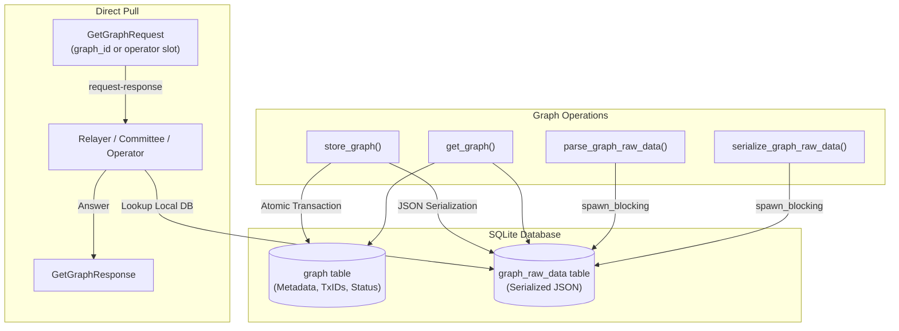

**Description**: Graph storage uses a two-table approach: `graph` for metadata/transaction IDs and `graph_raw_data` for full serialized graph JSON. Large graph serialization uses `spawn_blocking` to prevent async runtime blocking. The `graph` table is unique per `(operator_pubkey, kickoff_index)`: one definition per operator slot.

### Fig-05-2-Graph-Pull-Sequence

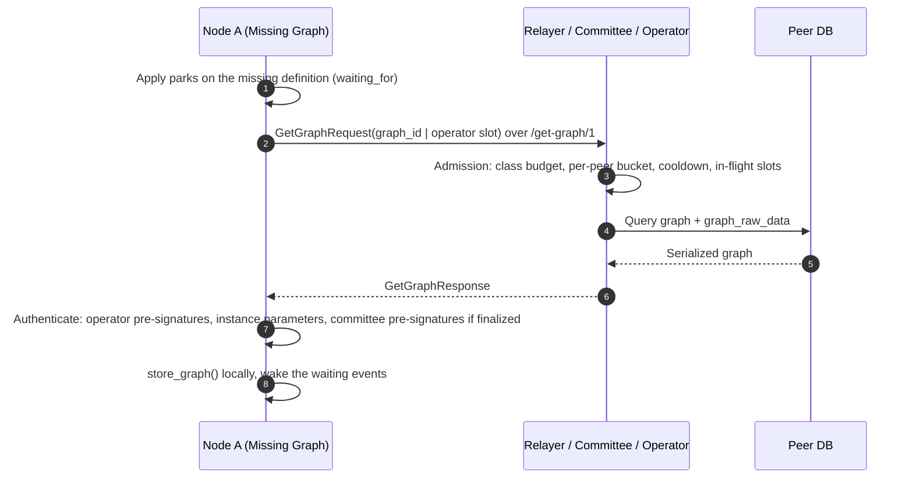

**Description**: The `fetch_graph` job of the Graph aggregate asks relayers and committee members first and the operator last; a definition claimed to be finalized must carry valid committee pre-signatures, and a graph already posted on GOAT is never accepted as an unsigned copy. Serving is rate limited per requester class and per peer (see `docs/node-protocol.md` §2.3).

### Graph Data Tables

#### graph table (Metadata)

| Column | Type | Description |
|--------|------|-------------|
| `graph_id` | UUID | Primary key |
| `instance_id` | UUID | Associated bridge instance |
| `status` | String | Current GraphStatus |
| `sub_status` | String | Challenge sub-status JSON |
| `operator_pubkey` | String | Operator's public key |
| `*_txid` | Txid | Transaction IDs for all graph transactions |
| `created_at`, `updated_at` | i64 | Timestamps |

#### graph_raw_data table (Full Graph)

| Column | Type | Description |
|--------|------|-------------|
| `graph_id` | UUID | Primary key (FK to graph) |
| `raw_data` | TEXT | JSON-serialized SimplifiedbitvmGraph |
| `created_at`, `updated_at` | i64 | Timestamps |

---

## Message System

### Fig-06-1-Message-Structure

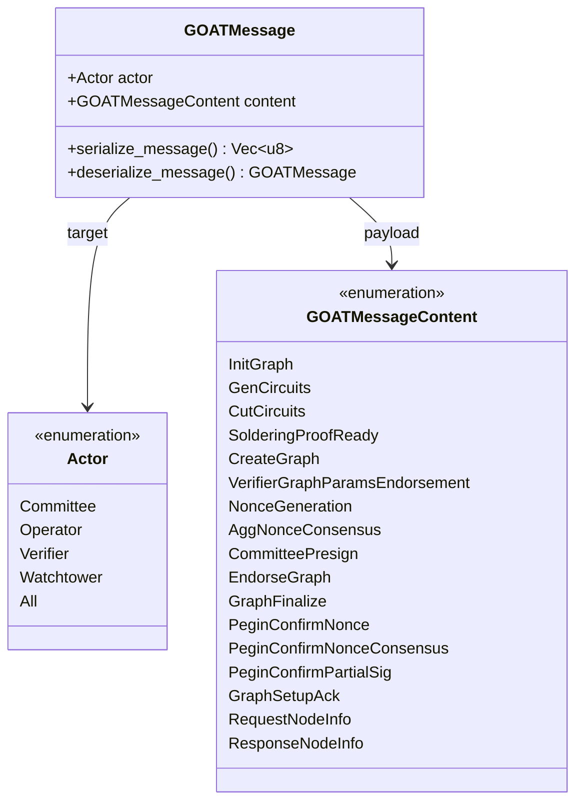

**Description**: The message system uses role-based addressing. Each message specifies a target topic and a content type, broadcast via Gossipsub. Messages are JSON (`GenCircuits` is bincode behind a `GOATBIN1` prefix). Only the 17 kinds above exist on the wire; chain observations are engine events, never messages. An admitted durable message becomes an inbox event of its aggregate (content id `H(author ‖ kind ‖ business id ‖ H(payload))`), so a re-published copy is a no-op; heavy messages are acknowledged with `GraphSetupAck` once their material is durably stored.

### Message Categories

#### Graph setup and signing (Graph aggregate)

| Message | Sender | Receiver | ACK | Description |
|---------|--------|----------|-----|-------------|
| `InitGraph` | Operator | Verifier | no | Recruit verifiers for a new graph |
| `GenCircuits` | Verifier | Operator | yes | Candidate's circuit setup package |
| `CutCircuits` | Operator | Verifier | yes | Which circuits the candidate opens or proves |
| `SolderingProofReady` | Verifier | Operator | yes | Soldering proof descriptor (payload out of band) |
| `CreateGraph` | Operator | Verifier, Committee | yes | The operator-presigned graph definition |
| `VerifierGraphParamsEndorsement` | Verifier | Committee | no | Verifier's endorsement of the graph parameters |
| `NonceGeneration` | Committee | Committee, Operator | no | MuSig2 public nonces |
| `AggNonceConsensus` | Committee | Committee | no | Signature over the agreed nonce set |
| `CommitteePresign` | Committee | Committee, Operator | no | Committee partial signatures |
| `EndorseGraph` | Committee | Operator | no | EVM endorsements of the graph |
| `GraphFinalize` | Operator | All | yes | The finalized graph with every endorsement |

#### Peg-In-Confirm round (Instance aggregate, committee only)

| Message | Sender | Receiver | Description |
|---------|--------|----------|-------------|
| `PeginConfirmNonce` | Committee | Committee | Deterministic nonce for the Peg-In-Confirm |
| `PeginConfirmNonceConsensus` | Committee | Committee | Signature over the agreed nonce set |
| `PeginConfirmPartialSig` | Committee | Committee | Partial signature plus the EVM endorsement the relayer posts |

#### Control messages (not persisted)

| Message | Sender | Receiver | Description |
|---------|--------|----------|-------------|
| `GraphSetupAck` | Receiver of a heavy message | Sender | Delivery acknowledged (`delivery_id`) |
| `RequestNodeInfo` / `ResponseNodeInfo` | Any | All | Peer discovery and the operator key binding |

Peg-out has no messages: the Graph aggregate scans both chains every Bitcoin block and turns what it sees (kickoff, challenge, asserts, takes) into jobs for the roles concerned.

---

## Scheduled Tasks

### Fig-07-1-Task-Overview

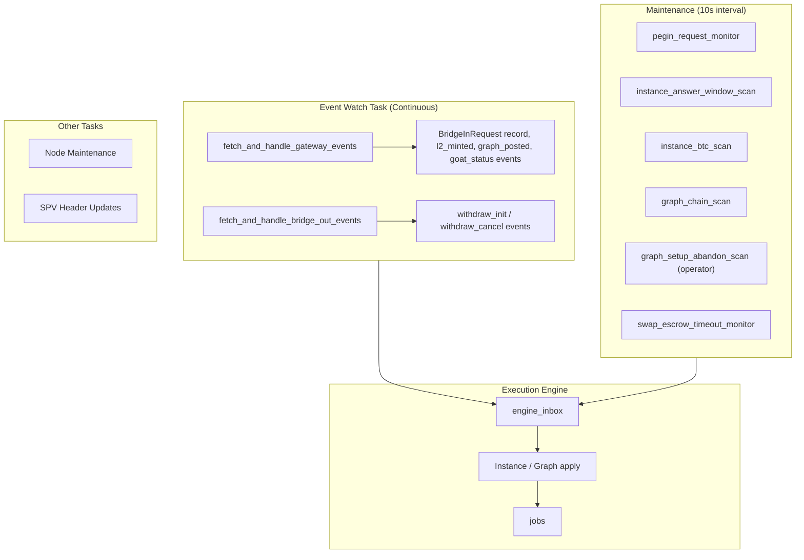

**Description**: The event watcher indexes GOAT events; the maintenance tick gathers chain facts (it is the only place that queries the chains for the aggregates) and records them as inbox events; the engine applies them and runs the resulting jobs. No task decides a status by itself.

### Task Responsibilities

| Task | Interval | Responsibility |
|------|----------|----------------|
| `run_watch_event_task` | Continuous | Index GOAT gateway and swap events; record `l2_minted`, `graph_posted`, `goat_status`, `withdraw_init` / `withdraw_cancel` events |
| `pegin_request_monitor` | 10s | Turn pending `BridgeInRequest` records into instance rows and `pegin_request` events (committee nodes answer from the event); late requests with spent inputs are recorded `UserDiscarded` |
| `instance_answer_window_scan` | 10s | Record the committee answers of each `UserInited` instance once its GOAT response window closed |
| `instance_btc_scan` | 10s | One `btc_snapshot` per live instance and Bitcoin height: Prepare / Confirm / Cancel status and input spends |
| `graph_chain_scan` | 10s | One `chain_scan` per non-closed graph and Bitcoin height: chain stage, unusable facts, peg-out signals |
| `graph_setup_abandon_scan` | 10s (operator) | Give up the operator's unfinished setups once the instance passed its abandon height |
| `swap_escrow_timeout_monitor` | 10s | Mark swap escrows past their refund deadline as timed out |
| `node_available_pbtc_update_monitor` | 10s (operator, relayer) | Refresh the node's available pegBTC |
| `spv_header_hash_update` | Periodic | Update SPV header hashes |
| `babe_setup_state_cleanup_monitor` | 10s (optional) | Remove orphaned BABE setup state files |

Admission maintenance (registry refresh, drop summaries, node table purge) runs on its own 20-second timer next to the swarm.

---

## Module Structure

```
node/src/
├── main.rs                          # Entry point, starts the background tasks and the engine
├── lib.rs                           # Module exports
├── action.rs                        # Wire message types, admission entry point, publish
├── handle.rs                        # Control messages (NodeInfo, GraphSetupAck)
├── p2p_admission.rs                 # Inbound admission: registry, replay window, rate limits, quota
├── p2p_msg_handler.rs               # Swarm handler: admission, control worker, GetGraph service
├── engine_bridge.rs                 # Engine assembly, gossip transport, ACK forwarder
├── aggregates/                      # Aggregates on the execution engine
│   ├── instance.rs                  # Instance apply: deadlines, F, Answer/Presign/Confirm/Post phases
│   ├── instance_jobs.rs             # answerPeginRequest, confirm_instance, PeginConfirm round, post
│   ├── instance_scan.rs             # Bitcoin / answer-window facts for instances
│   ├── graph.rs                     # Graph apply: setup, collect, signing, deliver, post
│   ├── graph_jobs.rs                # Setup, signing and finalize jobs
│   ├── graph_setup.rs               # Setup helpers
│   ├── graph_fetch.rs               # GetGraph pull and authentication
│   ├── graph_pegout.rs              # Kickoff / Settlement apply, Skip premise
│   ├── graph_pegout_jobs.rs         # Peg-out jobs
│   └── graph_scan.rs                # Chain scan of every non-closed graph
├── env.rs                           # Environment configuration
├── utils.rs                         # Graph state management & storage utilities
├── error.rs                         # Error types
├── vk.rs                            # Verification key management
├── metrics_service.rs               # Prometheus metrics
├── rpc_service/                     # REST API implementation
│   ├── mod.rs                       # Service orchestration
│   ├── bitvm.rs                     # BitVM-specific endpoints
│   ├── routes.rs                    # HTTP route definitions
│   ├── validation.rs                # Input validation
│   └── handler/                     # Request handlers
├── middleware/                      # P2P network layer
│   ├── swarm.rs                     # BitvmNetworkManager, libp2p configuration
│   ├── behaviour.rs                 # Kademlia + Gossipsub + GetGraph behaviour
│   ├── get_graph.rs                 # GetGraph request-response codec
│   ├── publisher.rs                 # Bounded access to the swarm from other tasks
│   └── connection_gate.rs           # Inbound connection limits
└── scheduled_tasks/                 # Background tasks
    ├── mod.rs                       # Maintenance tick
    ├── event_watch_task.rs          # Chain event monitoring
    ├── instance_maintenance_tasks.rs # Peg-in request monitor, swap timeouts
    ├── node_maintenance_tasks.rs    # Node health
    └── spv_maintenance_tasks.rs     # SPV updates
```

The execution engine itself lives in `crates/engine`; its tables (`engine_inbox`, `engine_aggregate`, `engine_outbox`, `engine_job`) in `crates/store`.

---

## Build & Run

### Prerequisites

- Rust nightly-2025-06-30+
- ZKM toolchain (optional, for proof generation)

### Build Commands

```bash
# Build for regtest
BITCOIN_NETWORK=regtest cargo build -r

# Build for testnet4
BITCOIN_NETWORK=testnet4 cargo build -r

# Build only the node binary
cargo build -r -p bitvm-noded
```

### Generate Node Keys

```bash
# Generate P2P peer key
bitvm-noded key peer
# Output:
# PEER_KEY=<base64-encoded-key>
# PEER_ID=<peer-id>

# Generate funding address (for Operator/Verifier)
bitvm-noded key funding-address
# Output:
# Funding P2WSH address: bc1q...
```

### Start Node

```bash
bitvm-noded \
  --rpc-addr 0.0.0.0:8080 \
  --metrics-addr 127.0.0.1:9108 \
  --db-path ./node.db \
  --p2p-port 4001 \
  --bootnodes /ip4/x.x.x.x/tcp/4001/p2p/<peer_id>
```

### Start Local Mock RPC

Use this when you only need to test HTTP interfaces. It starts the RPC routes without
P2P, chain watchers, or maintenance tasks, and seeds a local SQLite database with
mock nodes, instances, graphs, and overview data.

```bash
cargo run -p bitvm-noded --bin mock-rpc -- --rpc-addr 127.0.0.1:18080
```

Useful test calls:

```bash
curl http://127.0.0.1:18080/v1/nodes/overview
curl http://127.0.0.1:18080/v1/instances
curl http://127.0.0.1:18080/v1/swaps
curl http://127.0.0.1:18080/v1/graphs
```

The mock binary prints seeded instance and graph IDs on startup. Endpoints that
require real `graph_raw_data`, such as graph transaction hex export, still need
real graph raw data in the database.

### CLI Options

| Option | Description | Default |
|--------|-------------|---------|
| `--rpc-addr` | RPC service bind address | `0.0.0.0:8080` |
| `--db-path` | SQLite database path | `sqlite:/tmp/bitvm-node.db` |
| `--p2p-port` | P2P listen port | `0` (random) |
| `--bootnodes` | Bootstrap node addresses | - |
| `--metrics-addr` | Dedicated Prometheus listener address | Disabled |
| `--metrics-path` | Path served by the dedicated metrics listener | `/metrics` |
| `--enable-kademlia` | Enable Kademlia DHT | `true` |

---

## Configuration

### Environment Variables

| Variable | Required | Description | Default |
|----------|----------|-------------|---------|
| `ACTOR` | Yes | Node role: `Committee`, `Operator`, `Verifier`, `Watchtower` | `Verifier` |
| `BITCOIN_NETWORK` | Yes | Bitcoin network: `bitcoin`, `testnet4`, `signet`, `regtest` | `testnet4` |
| `GOAT_NETWORK` | Yes | GOAT network: `main`, `test` | `test` |
| `GOAT_CHAIN_URL` | Yes | GOAT L2 RPC endpoint | - |
| `GOAT_GATEWAY_CONTRACT_ADDRESS` | Yes | Gateway contract address | - |
| `BITVM_SECRET` | Yes | Node private key or seed (`seed:xxx` format) | - |
| `PEER_KEY` | Yes | libp2p node key (Base64 encoded) | - |
| `GOAT_PRIVATE_KEY` | Conditional | GOAT chain private key (required for Committee) | - |
| `GOAT_ADDRESS` | Conditional | GOAT address (required for Operator/Verifier) | - |
| `ENABLE_RELAYER` | No | Enable relayer mode for Committee nodes | `false` |
| `ENABLE_BABE_SETUP_STATE_CLEANUP` | No | Enable scheduled BABE setup state cleanup for Operator/Verifier nodes | `false` |
| `BTC_CHAIN_URL` | No | Bitcoin Esplora API endpoint | Public Esplora |
| `NODE_NAME` | No | Node display name | `ZKM` |
| `OPERATOR_NODE_SERVICE_FEE` | No | Operator service fee rate | `0.001` |
| `ENABLE_COMMITTEE_INSTANCE_KEY_DELETE` | No | Delete the committee instance key envelope when the instance fails (except `Timeout`) or 32 blocks after the Peg-In-Confirm confirmed; off, the intent is only logged | `false` |
| `COMMITTEE_INSTANCE_KEY_DELETE_TIMELOCK_BLOCKS` | No | Number of BTC blocks to wait after pegin-confirm confirmation before deleting key envelope | `32` |
| `PEGIN_ABANDON_BUFFER_BLOCKS` | No | Blocks after `Prepare height + connector_z` before an instance whose Peg-In-Confirm is neither confirmed nor in the mempool is abandoned | `18` / `14` / `3` / `6` by network |
| `OPERATOR_GRAPH_START_CUTOFF_BLOCKS` | No | Operators start no new graph for an instance past `Prepare height + cutoff` | `⌊2·connector_z/3⌋` |
| `ENGINE_WORKER_COUNT` / `ENGINE_CPU_POOL_SLOTS` / `ENGINE_PEGOUT_POOL_SLOTS` / `ENGINE_NETWORK_POOL_SLOTS` | No | Execution engine: aggregate workers, concurrent CPU-bound setup jobs, concurrent CPU-bound peg-out jobs (own slots, so a graph build never delays a challenge), concurrent network jobs | `1` / `1` / `1` / `4` |
| `ENGINE_APPLY_TIMEOUT_SECS` / `ENGINE_RECHECK_INTERVAL_SECS` | No | Execution engine: apply budget (also the SQLite busy timeout) and the re-check of waiting events | `120` / `60` |
| `P2P_MAX_JSON_MESSAGE_BYTES` | No | Largest JSON gossip message accepted | `2 MiB` |
| `P2P_INBOX_MAX_QUEUED_BYTES` | No | Payload bytes of admitted network events the engine inbox may hold (the committee reserve and per-peer quotas derive from it; unregistered authors are relayed, never stored) | `2 GiB` |
| `P2P_MAX_INCOMING_CONNECTIONS` / `P2P_INBOUND_REGISTERED_RESERVE` | No | Inbound connection ceiling and the slots reserved for registered peers | `512` / `128` |
| `P2P_RESERVED_PEERS` / `P2P_TRUSTED_OPERATOR_BINDINGS` | No | Peers that always get a connection slot; configured operator key bindings | empty |

### Relayer Configuration

To run a Committee node as a graph data relayer:

```bash
export ACTOR=Committee
export ENABLE_RELAYER=true
export GOAT_PRIVATE_KEY=<private_key>
# ... other required variables
```

Relayer nodes should:
- Run 24/7 for network reliability
- Have sufficient storage for all graph data
- Be geographically distributed for redundancy

---

## RPC API

Prometheus metrics are not served by the business RPC listener. Set
`--metrics-addr` to a private, process-unique address and scrape
`http://<metrics-addr>/metrics`; `GET /metrics` on `--rpc-addr` returns `404`.

### Endpoints

| Endpoint | Method | Description |
|----------|--------|-------------|
| `/node` | GET | Get current node information |
| `/nodes` | GET | List connected nodes |
| `/nodes/overview` | GET | Node statistics overview |
| `/instances` | GET | List all instances |
| `/instance/:id` | GET | Get instance details |
| `/instances/overview` | GET | Instance statistics overview |
| `/v1/graphs` | GET | List all graphs |
| `/v1/graphs/:id` | GET | Get graph details |
| `/v1/graphs/:id/txn?cursor=0` | GET | Get graph transaction list |
| `/v1/graphs/:id/tx?tx_name=cur-pre-kickoff.hex` | GET | Get specific transaction hex |
| `/v1/graphs/ready-to-kickoff` | GET | Get graphs ready for kickoff |
| `/bridge_in_request` | POST | Initiate Bridge-In request |
| `/v1/swaps` | GET | List swap bridge-out escrows |
| `/v1/swaps/:escrow_hash` | GET | Get swap escrow details |
| `/challenge` | POST | Submit challenge |
| `/metrics` | GET | Prometheus metrics (dedicated metrics listener only) |
| `/v1/debug/status`, `/v1/debug/engine` | GET | Node status and the execution engine snapshot (rows by state, waiting and poisoned aggregates); `rpc-debug-endpoints` feature only |

---

## Related Documentation

- [Architecture Document](../docs/ARCHITECTURE.md) - Full system architecture
- [Circuits README](../circuits/README.md) - ZK proof generation
- [Deployment Guide](../deployment/README.md) - Deployment instructions
- [Incentives](../docs/incentives.md) - Incentives
